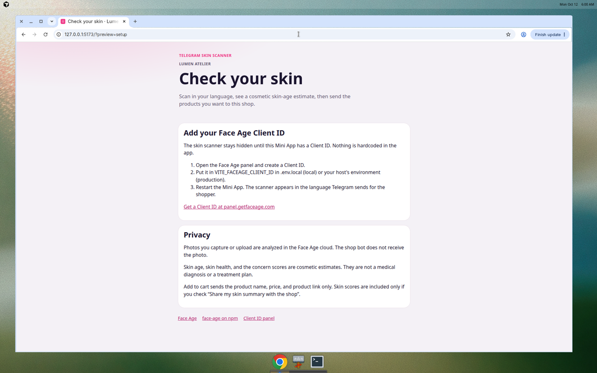
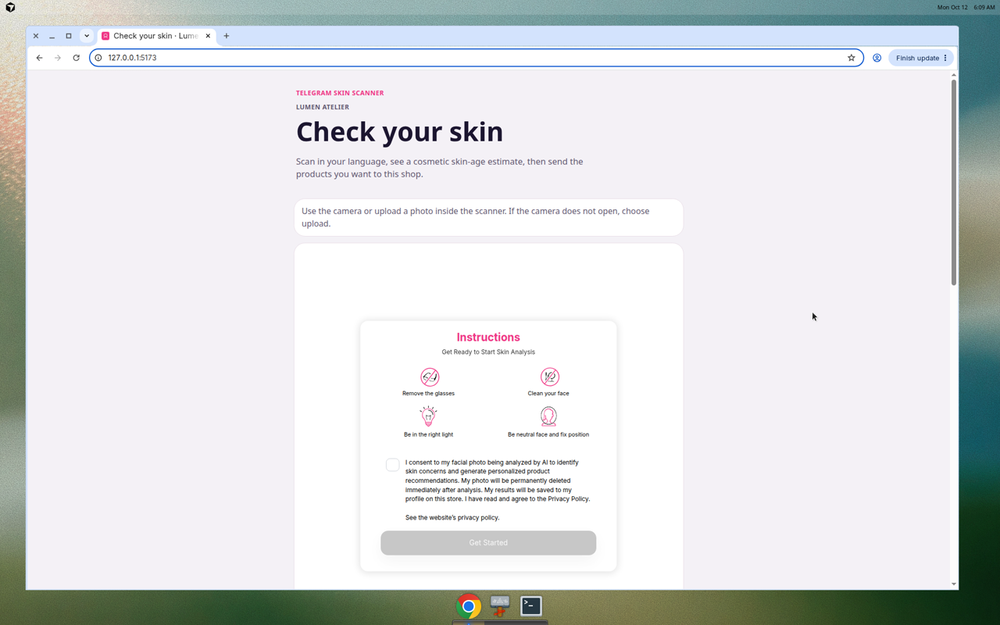
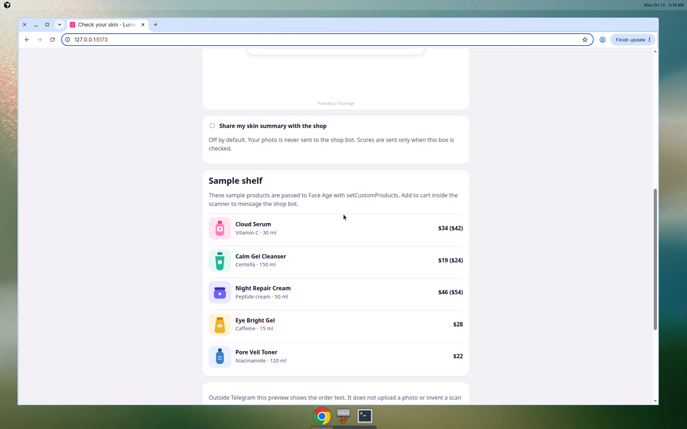
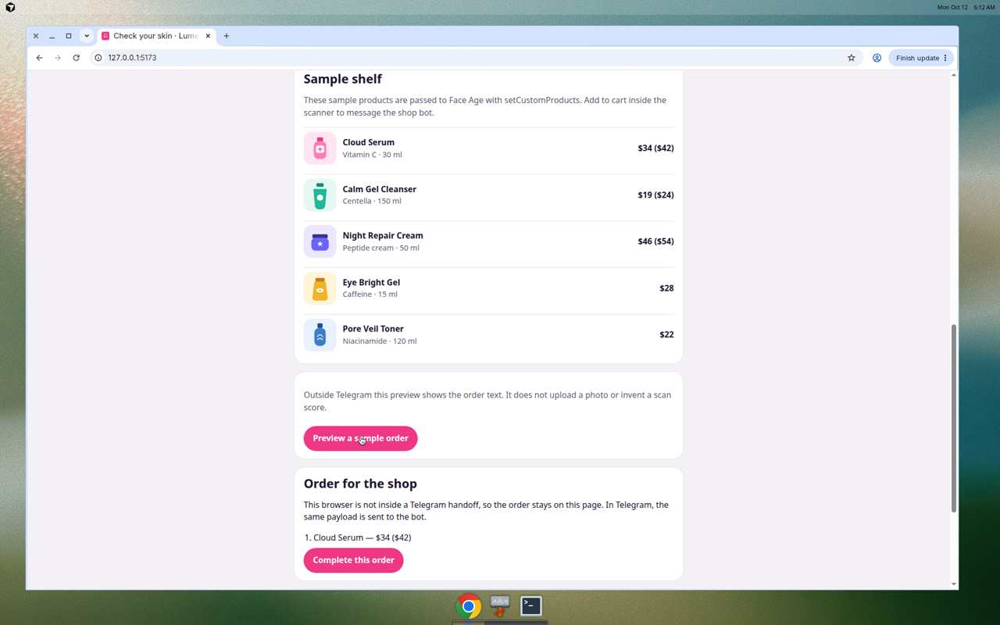
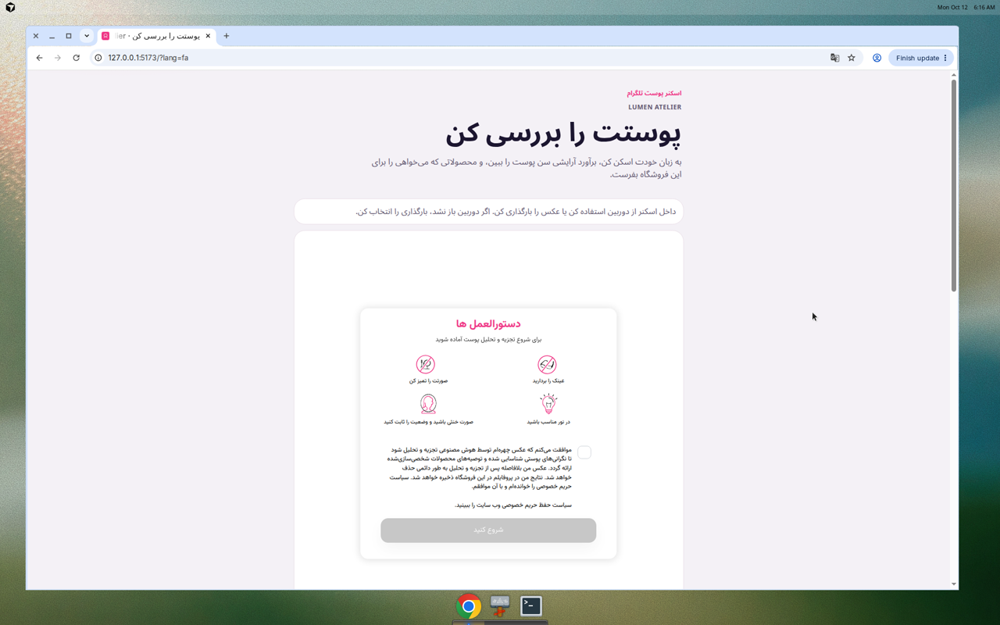

# Telegram Mini App Skin Scanner for Beauty Shops

A Telegram Mini App and a small grammY bot that let a beauty shop run an in-chat **skin scanner**. Shoppers open Face Age in their own language, including right-to-left Persian, Arabic, and Urdu, then send the products they want back to the shop bot.

The scanner is the browser widget from the [`face-age`](https://www.npmjs.com/package/face-age) package by [Face Age](https://getfaceage.com/). It estimates skin age, a skin-health or damage score, and 13 visible concerns. It does not estimate real age or gender. Photos are analyzed in the Face Age cloud.

Built for beauty shops and creators who sell through Telegram channels in Iran, the CIS, and the Middle East.


## Screenshots

Captured in a desktop browser, outside Telegram. The Face Age widget keeps its own internal frame.











## Features

- Telegram Mini App shell that reads the shopper's language and Telegram theme colors.
- Face Age widget rendered in one of 40 languages, with RTL layout for `fa`, `ar`, and `ur`.
- Camera capture plus an upload-photo path for Telegram webviews that block the camera.
- Sample beauty-shop catalog passed in with `API.setCustomProducts()`.
- Add to cart and checkout call `Telegram.WebApp.sendData`, so the bot can reply with an order link.
- grammY bot with a **Check your skin** keyboard button, long polling for local work, and a Vercel webhook.
- Photos and skin scores stay out of the bot unless the shopper explicitly shares a summary.

## How it works

1. The shop posts a **Check your skin** button, or the shopper opens the bot and taps the keyboard button.
2. The Mini App reads `language_code` from Telegram and opens Face Age in that language. Persian, Arabic, and Urdu use RTL.
3. The shopper scans with the camera or uploads a photo and sees skin age, skin health, concerns, and the shop's products.
4. **Add to cart** sends the product (name, price, link, chosen size) with `Telegram.WebApp.sendData`. The photo is not attached.
5. The bot replies in the chat with an order link. Checkout sends the whole cart the same way.

If Telegram opened the Mini App from a menu button or a direct link, `sendData` may not deliver. The page then posts the same product payload to `/api/order`. The function checks Telegram `initData` and messages the shopper. Outside Telegram, the page shows the order text locally so you can demo the handoff without a bot.

## Quick start

Requires Node.js 20 or newer.

```bash
git clone https://github.com/miladmostafa/face-age-telegram-miniapp.git
cd face-age-telegram-miniapp
npm install
```

Install the skin-scanner widget:

```bash
npm install face-age@latest
```

Create a local env file and add your Client ID (see [Configuration](#configuration)):

```bash
cp .env.example .env.local
```

Start the Mini App:

```bash
npm run dev
```

Open `http://localhost:5173`. Add `?lang=fa` to preview Persian (RTL) outside Telegram. Add `?preview=setup` to preview the missing Client ID screen.

In another terminal, after you set `BOT_TOKEN`:

```bash
npm run bot
```

## Configuration

### Face Age Client ID

The widget will not render until `VITE_FACEAGE_CLIENT_ID` is set. The repository does not ship a default Client ID.

1. Open [panel.getfaceage.com](https://panel.getfaceage.com/) and create a free account.
2. Copy the Client ID from the panel.
3. For local development, put it in `.env.local`:

```bash
VITE_FACEAGE_CLIENT_ID=your_client_id
```

4. On Vercel or Cloudflare Pages, set the same variable in the project environment and redeploy.

If the variable is empty, the Mini App shows setup steps and links to the panel instead of starting the scanner.

Optional browser settings:

| Variable | Purpose |
| --- | --- |
| `VITE_SHOP_NAME` | Replaces the sample shop name `Lumen Atelier`. |
| `VITE_CURRENCY` | Price prefix passed to Face Age. The sample catalog uses `$`. |
| `VITE_BOT_USERNAME` | Reserved for your bot username in deploy notes. |

### Bot

| Variable | Purpose |
| --- | --- |
| `BOT_TOKEN` | Token from [@BotFather](https://t.me/BotFather). Server only. Never prefix it with `VITE_`. |
| `MINI_APP_URL` | HTTPS URL of this Mini App. The `/start` keyboard opens it. |
| `ORDER_BASE_URL` | Checkout URL. The bot appends `items` and `source=telegram-skin-scan`. |

Telegram only accepts an **HTTPS** Mini App URL (a tunnel or a deployed host). `http://localhost` is for browser development of the page, not for a real keyboard button.

### Sample products

`data/sample-products.json` is a five-product shelf (serum, cleanser, night cream, eye gel, toner). Edit that file to match a real catalog. Each product needs an `id`, `title`, `price`, an `http` or `https` `url`, and an image path. Concern keys use the Face Age names: `fineWrinkles`, `eyeWrinkles`, `deepWrinkles`, `darkCircle`, `eyeBag`, `pores`, `pigment`, `redness`, `oiliness`, `dryness`, `sagginess`, `dullness`, `acne`.

The page resolves image paths to absolute URLs and calls `faceAge.API.setCustomProducts()` after `render()`.

### Languages

Face Age supports 40 language codes:

`ar` `bg` `bn` `cs` `da` `de` `el` `en` `es` `et` `fa` `fi` `fr` `he` `hi` `hr` `hu` `id` `it` `ja` `ko` `lt` `lv` `ms` `nl` `no` `pl` `pt` `ro` `ru` `sk` `sr` `sv` `th` `tl` `tr` `uk` `ur` `vi` `zh`

The Mini App maps Telegram codes such as `fa-IR`, `pt-br`, `zh-hans`, `nb`, and `fil` onto that list. Unknown codes use English. `fa`, `ar`, and `ur` set `dir="rtl"` on the page. Face Age applies the same RTL switch inside the widget.

The shop shell is translated for English, Persian, Arabic, Urdu, and Russian. Other languages still drive the Face Age widget; the shell falls back to English.

## Deploy

### Mini App on Vercel

1. Import the repository. Framework preset can stay empty. `vercel.json` builds with `npm run build` and publishes `dist`.
2. Set `VITE_FACEAGE_CLIENT_ID`. Set `BOT_TOKEN`, `MINI_APP_URL`, and `ORDER_BASE_URL` for the bot functions.
3. Deploy. The page is the site root. `POST /api/telegram` is the bot webhook. `POST /api/order` is the sendData fallback.

`VITE_*` values are baked in at build time. Change the Client ID, then redeploy.

### Mini App on Cloudflare Pages

1. Build command: `npm run build`. Output directory: `dist`.
2. Set `VITE_FACEAGE_CLIENT_ID`, then deploy.
3. Run the bot somewhere that can hold `BOT_TOKEN` (a small Node process or the Vercel functions above). Cloudflare Pages by itself does not run `api/telegram.ts`.

### BotFather

1. Create a bot with `/newbot` and copy the token into `BOT_TOKEN`.
2. Create a Mini App with `/newapp` (or Bot Settings → Configure Mini App / Menu Button).
3. Set the Mini App URL to the deployed HTTPS origin, and set `MINI_APP_URL` to that same URL.
4. Shoppers can open the bot and tap **Check your skin**. That reply-keyboard button is what makes `WebApp.sendData` deliver `web_app_data` to the bot.

A channel post cannot use a `web_app` keyboard button. Pin a URL button to `https://t.me/<bot_username>/<mini_app_short_name>` or to the HTTPS Mini App. Ask shoppers to tap **Start** in the bot once so the fallback message can be delivered.

### Webhook or long polling

Long polling (local or a VPS):

```bash
npm run bot
```

If a webhook was set earlier, delete it before polling:

```bash
curl "https://api.telegram.org/bot${BOT_TOKEN}/deleteWebhook"
```

Webhook on Vercel, after the deploy is live:

```bash
curl "https://api.telegram.org/bot${BOT_TOKEN}/setWebhook?url=https://YOUR_DOMAIN/api/telegram"
```

Do not run polling and a webhook at the same time.

## Privacy

- A photo taken or uploaded in the widget is sent to the **Face Age cloud** for analysis. Review [Face Age](https://getfaceage.com/) for how that service handles images.
- Results are cosmetic estimates of skin age, skin health or damage, and visible concerns. They are not a medical diagnosis, not a real-age or gender estimate, and not a treatment plan.
- The shop bot receives product id, title, price, quantity, variant, and product URL. It does not receive the photo.
- Skin scores are included only when the shopper checks **Share my skin summary with the shop**. The box is off by default.
- The fallback endpoint checks the Telegram `initData` signature (HMAC with the bot token) and rejects stale payloads older than 24 hours.

The widget creates its own internal frame, `iframe#FaceAge-module-iframe`, and writes the scanner into it. Do not remove, hide, or sandbox that frame. The module `div#FaceAge-module` stays directly in this page and is not wrapped in another frame. If you add a Content-Security-Policy, allow that child frame plus the widget's hosts (`https://static.getfaceage.com`, `https://cdn.jsdelivr.net`, and the Face Age API). A policy that blocks child frames or those hosts will blank the scanner. Adjust the policy instead of patching the frame out.

### Camera limits

Telegram webviews do not offer the camera on every phone. iOS and Android often block `getUserMedia` inside a Mini App. This app leaves both Face Age inputs on (`showCamera` and `showUpload`). When the platform is iOS, Android, or a Telegram webview, the page tells the shopper to use **Upload photo**. Upload uses the same analysis as the camera.

## Scripts

| Command | What it does |
| --- | --- |
| `npm run dev` | Vite dev server for the Mini App. |
| `npm run bot` | grammY long polling. |
| `npm test` | Unit tests (order payload, language, initData, handoff). |
| `npm run lint` | ESLint. |
| `npm run build` | Typecheck and production build. |
| `npm run check` | Lint, test, and build. |

## FAQ

### Where do I get a Client ID?

Create one in the [Face Age panel](https://panel.getfaceage.com/). Put it in `VITE_FACEAGE_CLIENT_ID`. The app links to the panel when the variable is missing.

### Does the bot store my photo?

No. Add to cart sends the product fields only. The photo stays with the Face Age analysis flow unless you build something extra, which this project does not do.

### Why did Add to cart not message the bot?

`WebApp.sendData` works when the Mini App was opened from the reply keyboard (**Check your skin**). Menu buttons and some direct links do not deliver `sendData`. Deploy `/api/order` with the same origin, and make sure the shopper has pressed Start in the bot. You can also confirm `MINI_APP_URL` is the HTTPS URL Telegram opened.

### Can I sell my own products?

Yes. Replace `data/sample-products.json`. Keep HTTPS image and product URLs. Set `ORDER_BASE_URL` to your checkout page if you want one order link instead of the first product URL.

### Is the skin age a medical result?

No. It is a cosmetic estimate for retail conversations. Do not present it as a diagnosis.

## License

MIT. See [LICENSE](LICENSE).

The `face-age` package is a separate library. Its license is on [npm](https://www.npmjs.com/package/face-age). This repository does not redistribute a modified copy of that widget.
